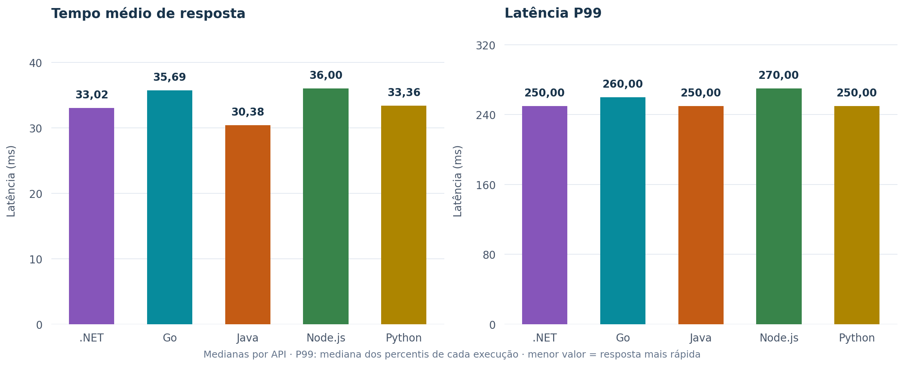
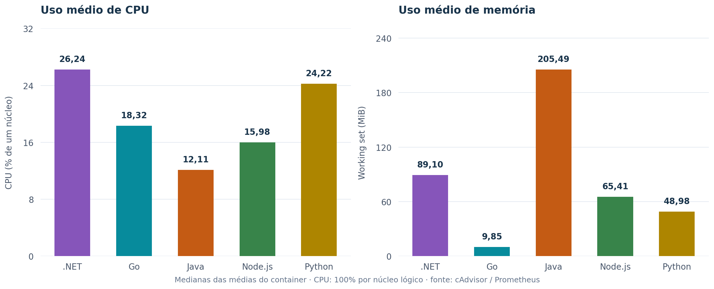
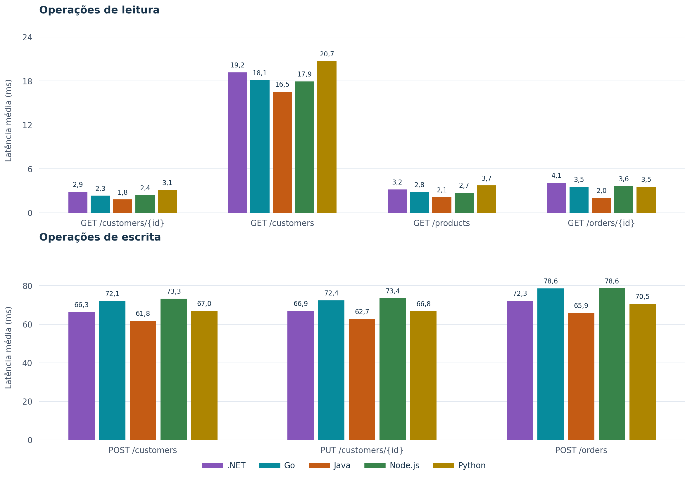
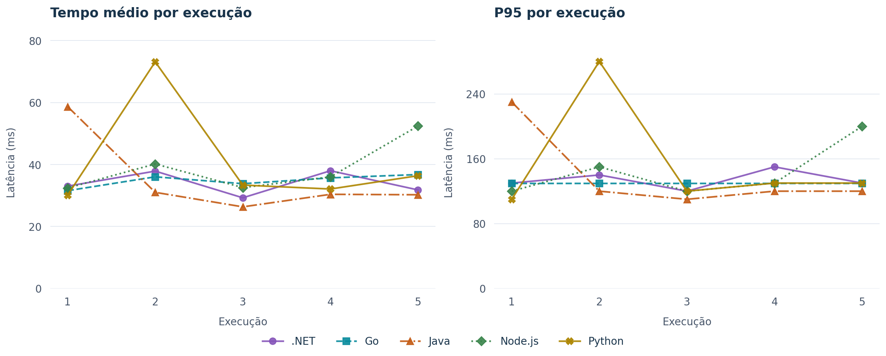

# Resultados da campanha oficial · fixed_100 · metodologia 17

Coleta de **10 a 12 de outubro de 2026**: cinco rodadas de cinco implementações, **25 execuções**, **749.796 requisições** e **zero falhas registradas pelo Locust**. Os arquivos foram publicados após a conclusão e preservam a classificação original `official`.

## Leitura dos resultados

| Linguagem | req/s | Média (ms) | P95 (ms) | P99 (ms) | CPU (%) | Memória (MiB) |
|---|---|---|---|---|---|---|
| .NET | 99.968 | 33.02 | 130 | 250 | 26.24 | 89.10 |
| Go | 99.974 | 35.69 | 130 | 260 | 18.32 | 9.85 |
| Java | 99.971 | 30.38 | 120 | 250 | 12.11 | 205.49 |
| Node.js | 99.972 | 36.00 | 130 | 270 | 15.98 | 65.41 |
| Python | 99.968 | 33.36 | 130 | 250 | 24.22 | 48.98 |

As métricas acima são **medianas entre as cinco rodadas**: mediana das médias de latência, dos P95/P99, da vazão e das médias de CPU/memória. Mediana de P95 não é o P95 global. CPU usa 100% por núcleo lógico; cada API tinha cota de dois núcleos. Memória é o working set do container.









As barras mostram medianas e as linhas mostram os valores de cada execução. Os eixos começam em zero; não há intervalos de confiança. Os gráficos descrevem esta campanha; não demonstram significância estatística ou superioridade geral de uma linguagem. As figuras por operação usam escalas separadas para leituras e escritas, ambas iniciadas em zero.

## Condições e validade

- 100 usuários, subida de 20 usuários/s, pacing de 1 s e quatro processos Locust.
- Carga fechada; 100 req/s é teto nominal. Todas as execuções superaram o piso de 95 req/s.
- Cinco minutos úteis por execução, excluindo warmup e subida de usuários; ordem das linguagens alternada entre rodadas.
- Sete operações no cenário `mixed`; `GET /health` não integra a medição.
- Fonte primária de CPU/memória: cAdvisor via Prometheus. Os critérios registrados exigem cobertura ≥95% e lacunas ≤1,5 s para API, PostgreSQL e Locust.
- Os snapshots foram novamente verificados por hash e reconciliados com os quatro workers, incluindo contagens, médias e histogramas P50/P95/P99. Limites temporais e gates registrados passaram em 25/25 execuções.
- Cobertura observada de CPU/memória: mínimo de 100.0%; maior lacuna de 1.391 s nas séries preservadas.
- Um único nível de carga: estes dados não medem capacidade máxima nem escalabilidade entre níveis.
- CPU e memória são do container inteiro, sem atribuição por endpoint. PostgreSQL é compartilhado; CPU baixa não elimina sua influência na latência.
- Percentis seguem o arredondamento dos histogramas Locust. Warmup, verificações e dados de `docker stats` estão preservados como evidência e não foram somados aos resultados oficiais.

## Proveniência e arquivos

- **Commit medido:** [`d2716c1f9187d47cdacaf15c837d232ca2560dc9`](https://github.com/luisgabrielMR/TCC-2/commit/d2716c1f9187d47cdacaf15c837d232ca2560dc9). A atualização posterior dos dashboards e esta publicação não alteram o protocolo da coleta.
- **Campanha:** `m17_d2716c1f9187_92483cd5afca`.
- **SHA-256 do protocolo:** `92483cd5afca4f1f87d559f9c4bccb307d127accb2a24c2c94f2ab05a9f3083a`. O hash é calculado sobre JSON canônico (chaves ordenadas, sem espaços), não sobre a formatação de `protocol.json`.
- [Protocolo](protocol.json), [manifesto e inventário de hashes](manifest.json), [resumo numérico](summary.json).
- [CSV por execução](tables/summary_by_language.csv) e [CSV por operação e execução](tables/summary_by_endpoint.csv).
- [Pacote completo de evidências originais](evidence.zip): 1201 arquivos, preservados byte a byte, incluindo warmup e o resumo da verificação de projeto anterior à coleta. Não contém `.env`.
- [Relatório HTML para baixar e abrir localmente](index.html): independente de Grafana/Docker. As figuras em SVG também estão na pasta `figures`.
- [SHA256SUMS](SHA256SUMS): integridade de todos os arquivos publicados, exceto o próprio arquivo de hashes.

## Conferência após baixar o repositório

Na raiz do projeto, execute (não exige Matplotlib):

```bash
python scripts/publish_official_results.py --verify results/official/2026-10-12_fixed_100_m17
```

Para conferir os CSVs novamente sem executar carga nem alterar o banco:

```bash
python -m zipfile -e results/official/2026-10-12_fixed_100_m17/evidence.zip results/summaries/official-review
python scripts/summarize_results.py --raw results/summaries/official-review/raw --processed results/summaries/official-review/processed --summaries results/summaries/official-review/report --campaign m17_d2716c1f9187_92483cd5afca
```

O material publicado é um retrato da campanha medida no commit indicado. O diretório `results/raw` local continua sendo área de trabalho; novas campanhas devem receber outra pasta de publicação e outro fingerprint.

Para gerar novamente as figuras e o pacote a partir dos resultados locais, use Python com `matplotlib==3.10.8` e execute `python scripts/publish_official_results.py --campaign m17_d2716c1f9187_92483cd5afca --output results/official/2026-10-12_fixed_100_m17`. A geração não executa benchmark nem promove resultados não oficiais.
